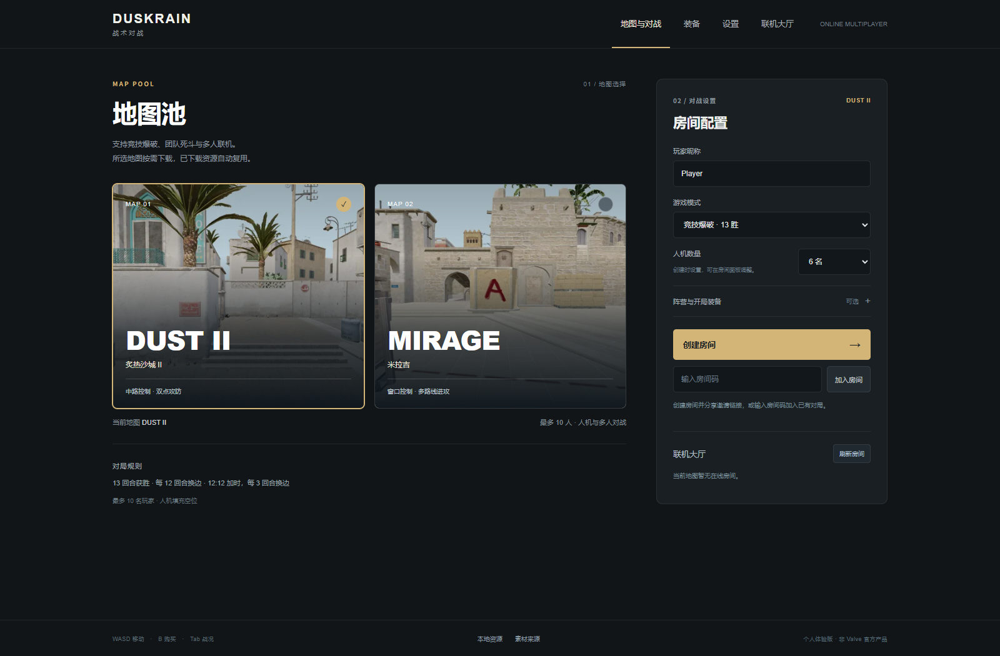
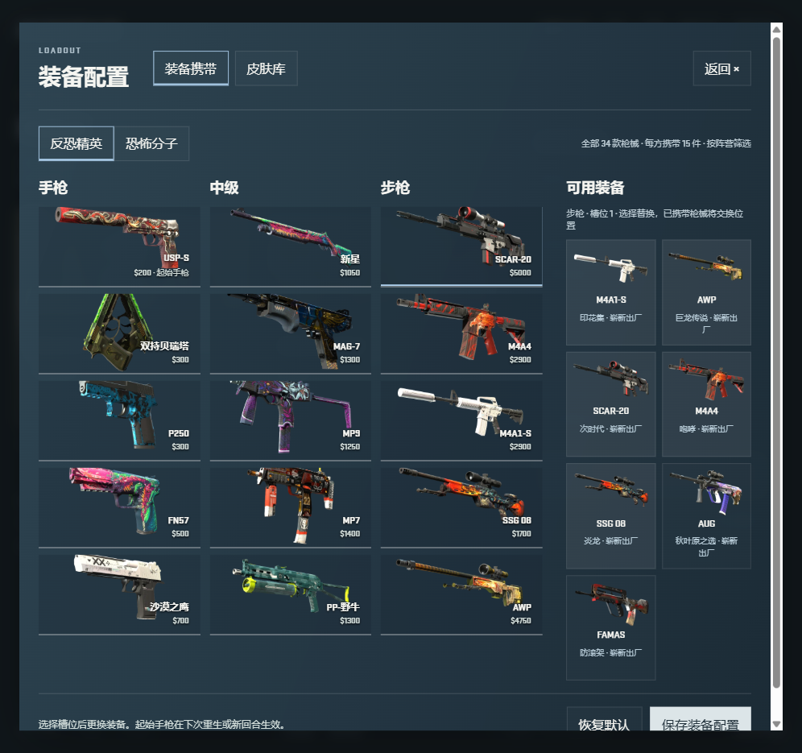
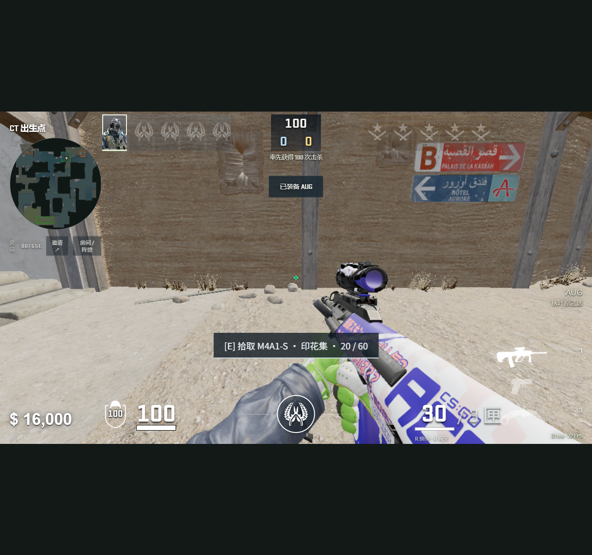
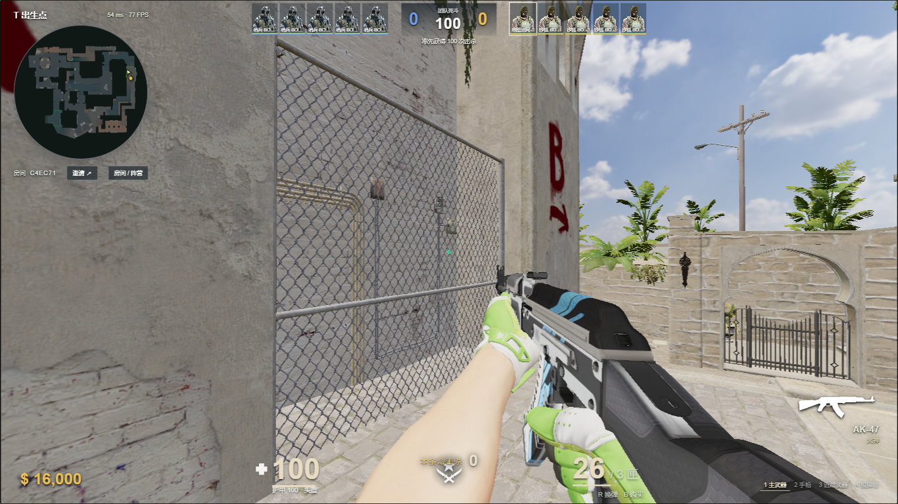
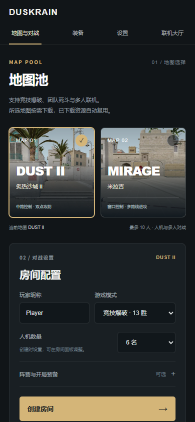

# DUSKRAIN · 网页战术对战

GPT-6 参与开发的第一人称射击项目，支持网页、Android 与 Windows 在线联机，包含服务器权威判定、战术人机与移动端操作。

[进入网页版](https://cs2.duskrain.cn/) · [1.3.0 更新](https://github.com/ETO-ze/dust2-web/releases/tag/online-v1.3.0) · [安装包下载](https://github.com/ETO-ze/dust2-web/releases/tag/online-v1.2.0-cdn.1) · [地图池说明](docs/PUBLIC-MAP-POOL.md) · [验证范围](docs/validation/public-map-pool.md)



*新版网页首页：地图选择、模式配置、人机数量、房间创建与联机大厅。*

## 网页版 1.3.0

沙二同步最新人机听觉、战术和装备系统；两张地图共用新版 HUD、键位操作、装备携带菜单与皮肤库。米拉吉保留现有地图资源、碰撞、导航、跳点和地图专用人机路线。

- **装备携带：** 全部 34 把枪械可选，每方携带 15 件；CT 起始手枪可选 USP-S／P2000，配置经过服务器确认后保存在本机。
- **皮肤库：** 50 款可选外观、35 个崭新默认外观；模型与新增动画按需加载，保留已有皮肤、手套和刀型选择。
- **局内操作：** 护甲数值居中、拆弹器与装备位置调整；商店连续购买进入队列；重复 F 不再重置检视，R 可取消，刀具 FR 切换平滑衔接。
- **对局反馈：** 己方全员阵亡且 C4 已安装时自动观战 C4，显示拆爆倒计时；听觉信息只提供近似位置，射击仍需视觉确认。



*实际浏览器截图：阵营装备携带、分类替换与崭新默认外观。*



*实际浏览器截图：新版 HUD、护甲数值、装备显示与 AUG 秋叶原之选。*

本次更新面向网站与公开源码；Android／Windows 下载包保持此前版本。详细变化与验证范围见 [1.3.0 更新说明](docs/ONLINE-1.3.0.md)。

## 地图池与资源加载

| 地图 | 网页入口 | 当前开放范围 |
| --- | --- | --- |
| Dust II · 炙热沙城 II | [进入沙二](https://cs2.duskrain.cn/play/de_dust2/) | 默认地图，支持人机与多人房间。 |
| Mirage · 米拉吉 | [进入米拉吉](https://cs2.duskrain.cn/play/de_mirage/) | 一个共享房间，最多 10 名玩家。 |

首页仅加载界面、地图预览与房间列表。选择地图不会启动三维场景；创建或加入房间后，才下载所选地图的资源。通用装备与声音跨地图复用，已下载文件按 SHA 缓存，资源变化时补下载对应文件。

地图、材质、武器和声音通过独立下载域名分发；房间、人机、命中和经济仍由游戏服务器计算。资源缓存减少重复传输，进入场景时仍需材质解码、碰撞初始化与显卡准备。



*公开米拉吉入口的电脑浏览器对战验证截图。*

## 对战功能

| 功能 | 作用 |
| --- | --- |
| 多人房间 | 双方共 10 个席位，支持 CT / T 选择、房间码加入与邀请链接分享，人机填充空位。 |
| 竞技爆破 | 率先获得 13 回合胜利；每 12 回合换边，12:12 进入加时。 |
| 团队死斗 | 团队累计 100 次击杀获胜。 |
| 战术人机 | 轻松、普通、困难三档；结合视线、枪声与队友信息选择路线和回防，保留平滑视觉瞄准。 |
| 装备与经济 | 商店购买、退枪、护甲、拆弹器、捡枪与丢枪；支持五类投掷物与 C4。 |
| 战况与协作 | 击杀反馈、爆头与助攻、死亡观战、E 接管人机、聊天和计分板。 |
| 个性化设置 | 皮肤选择、准星、灵敏度、亮度、清晰度、画面比例与帧率上限。 |

打开菜单不会暂停在线对局。切到后台时清理操作输入，返回后重新同步服务器状态。

## 移动端操作

触屏摇杆负责移动，右侧按键支持开火、跳跃、切枪与投掷。布局可拖动、缩放、调整透明度，并通过布局代码或设置备份保存。

陀螺仪支持对局中开启、仅开镜与关闭；提供两轴灵敏度、开镜倍率、反转和校准。轻度辅助瞄准在准星接近可见敌人时跟随躯干，遮挡、烟雾与致盲会取消辅助，命中仍由服务器判定。



*390×844 CSS 像素的浏览器布局检查截图。*

正式 Android 包使用 WebView；另有独立 GeckoView ARM64 测试包供内核比较。P60 真机持续帧率、温度和两种内核的对比尚未验收，正式内核保持 WebView。

## 安装与访问

| 入口 | 适用场景 | 下载与要求 |
| --- | --- | --- |
| 网页 | 直接访问地图池，与朋友在线对战。 | [cs2.duskrain.cn](https://cs2.duskrain.cn/)；首次进入所选地图需要下载资源。 |
| Android 正式包 | 基础素材随包安装，减少重复下载。 | [1.2.0-cdn.1 APK](https://github.com/ETO-ze/dust2-web/releases/download/online-v1.2.0-cdn.1/DustII-Android-1.2.0-cdn.1.apk)；Android 8+、WebView 110+、WebGL 2，沿用在线包名与签名。 |
| Windows 本地联机包 | 本地素材与运行时，连接正式联机服务器。 | [Windows x64 ZIP](https://github.com/ETO-ze/dust2-web/releases/download/online-v1.2.0-cdn.1/DustII-Windows-x64-20261004-102629.zip)；解压后运行 `Start-Game.cmd`。 |
| GeckoView 测试包 | 对比 Android 浏览器内核，可与正式包共存。 | [GeckoView ARM64 APK](https://github.com/ETO-ze/dust2-web/releases/download/online-v1.2.0/DustII-Gecko-Test-1.2.0.apk)。 |
| 独立离线版 | 无网络环境下与人机对战。 | [离线 0.2.0](https://github.com/ETO-ze/dust2-web/releases/tag/offline-v0.2.0) · [offline-v1 源码](https://github.com/ETO-ze/dust2-web/tree/offline-v1)。 |

本次 1.3.0 更新针对网页版。已发布的 Android 与 Windows 包仍使用沙二入口；下载附件未因网页更新而重新打包。在线对局仍需要网络，本地素材与 CDN 不会消除线路延迟。

## 开发与验证

需要 Node.js 22.12+：

```bash
npm ci
npm run assets:fetch
npm run build
npm start
```

运行自动测试：`node --test --test-concurrency=1 tests/*.mjs`。CDN 工具与配置见 [CDN 自动化说明](docs/CDN-AUTOMATION.md)。

公开源码包含网页菜单、联机客户端、地图运行时与 CDN 下载工具。原始地图导出、私有地图库、测试入口及部署诊断不包含在仓库内；自行部署米拉吉需要另行准备匹配签名的地图、碰撞与导航数据。沙二素材继续沿用现有获取流程。

地图池已进行实际浏览器进入、沙二移动与开火、米拉吉九人机和双客户端 WSS 加入／退出、共享缓存与首页按需加载验证。桌面、手机横屏和竖屏布局均已检查；这些结果不等同于 P60 真机或十名真人长时压力验收。详细范围见 [地图池说明](docs/PUBLIC-MAP-POOL.md)。

## 项目与素材来源

参考 [henhaogame/dust2-offline](https://github.com/henhaogame/dust2-offline) 的离线、触控和部分人机设计，并复用本项目离线 0.2.0 的决策模块进行联机适配。

个人体验项目，非 Valve 官方 CS2，不包含 Source 2 引擎。素材、音乐和第三方组件的归属见 [许可说明](LICENSE.md) 与 [素材来源](docs/ASSETS.md)。
