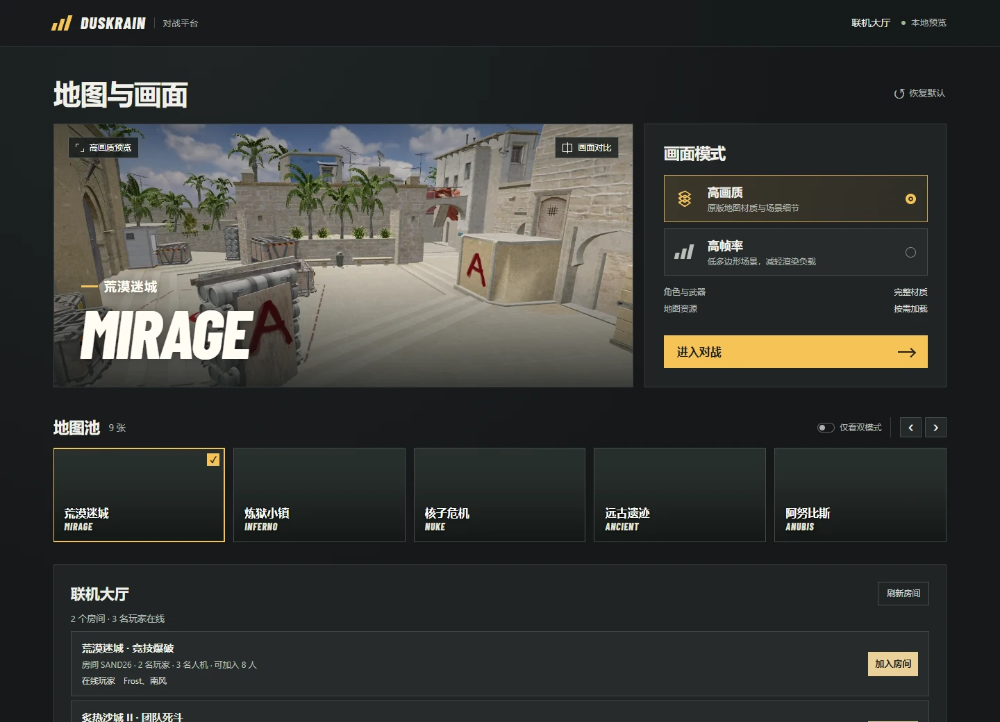
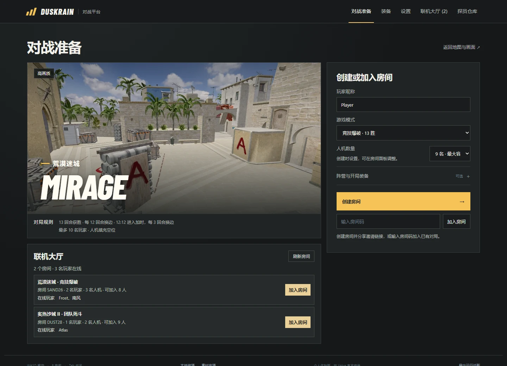
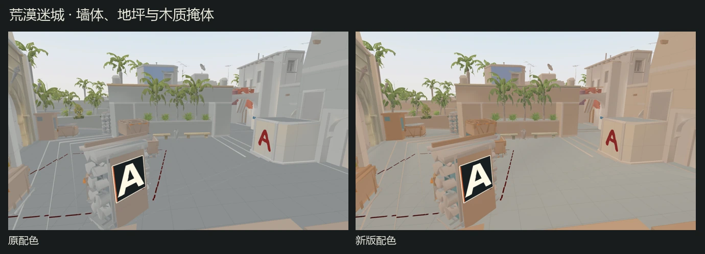
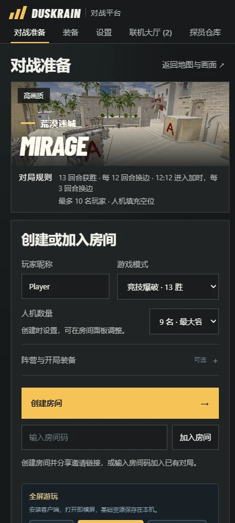

# DUSKRAIN · 网页战术对战

支持 5 对 5 的网页第一人称对战。玩家可以从联机大厅加入已有房间，也可以选择地图、画面模式和人机数量创建房间。游戏按所选地图加载资源，开火、命中、经济和人机由房间服务器计算。

[进入游戏](https://cs2.duskrain.cn/perf/) · [联机大厅](https://cs2.duskrain.cn/perf/#onlineRooms) · [下载九图发行包](https://github.com/ETO-ze/dust2-web/releases/tag/online-v1.4.0-perf.6) · [运行说明](docs/NINE-MAPS-LOBBY.md)

## 联机大厅

所有地图上的公开对局合并为一份列表。每行显示地图、模式、房间码、真人昵称、人机数量和可加入人数。大厅可见时每 5 秒更新，支持手动刷新。高画质与高帧率玩家可以同房。仅供邀请的房间可通过房间码加入。

## 地图与画面

| 画面模式 | 可用地图 |
| --- | --- |
| 高画质 | 炙热沙城 II、荒漠迷城、炼狱小镇 |
| 高帧率 | 上述三图，以及核子危机、远古遗迹、阿努比斯、死城之谜、列车停放站、殒命大厦 |

九张高帧率地图分别为墙板、金属、木料、灰泥、铺地和砌块调色。荒漠迷城用暖沙色墙面衬托灰色地坪，核子危机以冷灰蓝区分厂房与木箱。地图天空来自各自的原版材质，两种画面模式共用同一方向和曝光。桌面最高使用 4096 × 2048 的全景图，手机最高使用 2048 × 1024，每次只加载当前地图。

[九张地图实拍](docs/screenshots/nine-map-paint.webp) · [逐图天空对照](docs/screenshots/map-skies.webp) · [入口视角的 A、B 标牌](docs/screenshots/flat-site-markers.webp) · [九图 Blender 工程](https://github.com/ETO-ze/dust2-web/releases/tag/online-v1.4.0-perf.6) · [材质库与构建说明](docs/FLAT-SURFACES.md)

## 对战与装备

- **竞技爆破**采用 13 胜制，常规赛每 12 回合换边，12 比 12 进入加时。**团队死斗**以先取得 100 次击杀为胜。
- **战术人机**结合视线、枪声、队友信息和经济做决策。玩家阵亡后可观战，按 E 接管可用的己方人机。
- **装备与外观**支持阵营携带方案、购买与退枪、掉落拾取、护甲和拆弹器。对战准备页的「装备」可选择 216 款武器与刀具外观，「探员仓库」可分别配置 CT、T 两个阵营共 10 位探员，「音乐盒」可下载、试听和装备 13 套音乐。进入已有房间前，客户端按在场玩家的装备清单准备需要的素材。
- **手机操作**支持触屏摇杆、可编辑按键布局、陀螺仪和辅助瞄准。可分别设置清晰度、画面比例、亮度与帧率上限。

[网页版探员仓库实拍](docs/screenshots/web-agent-library.jpg)

## 下载与开发

九图服务器和浏览器客户端在同一发行页提供。发布附件附带 SHA-256 校验文件，安装步骤与本地验证方法见[九图运行说明](docs/NINE-MAPS-LOBBY.md)。另可下载[Android 与 Windows 在线客户端](https://github.com/ETO-ze/dust2-web/releases/tag/online-v1.2.0-cdn.1)及[独立离线版](https://github.com/ETO-ze/dust2-web/releases/tag/offline-v0.2.0)。

本项目由 GPT-6 参与开发。触控、离线运行与部分人机设计参考了 [dust2-offline](https://github.com/henhaogame/dust2-offline)。本项目与 Valve 无隶属关系。原创代码和文档采用 [MIT 许可证](LICENSE.md)。地图、音乐、外观及第三方组件的来源和使用条件见[第三方声明](THIRD-PARTY-NOTICES.md)与[素材来源](docs/ASSETS.md)。
