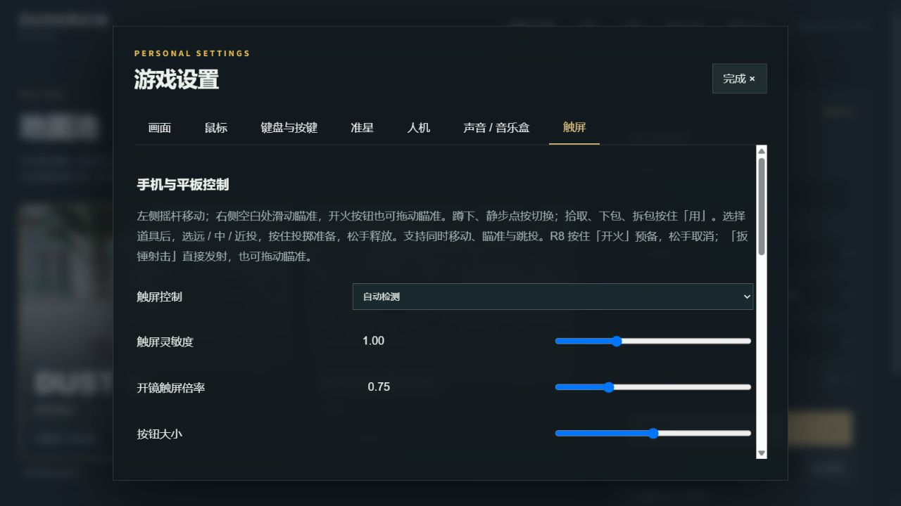
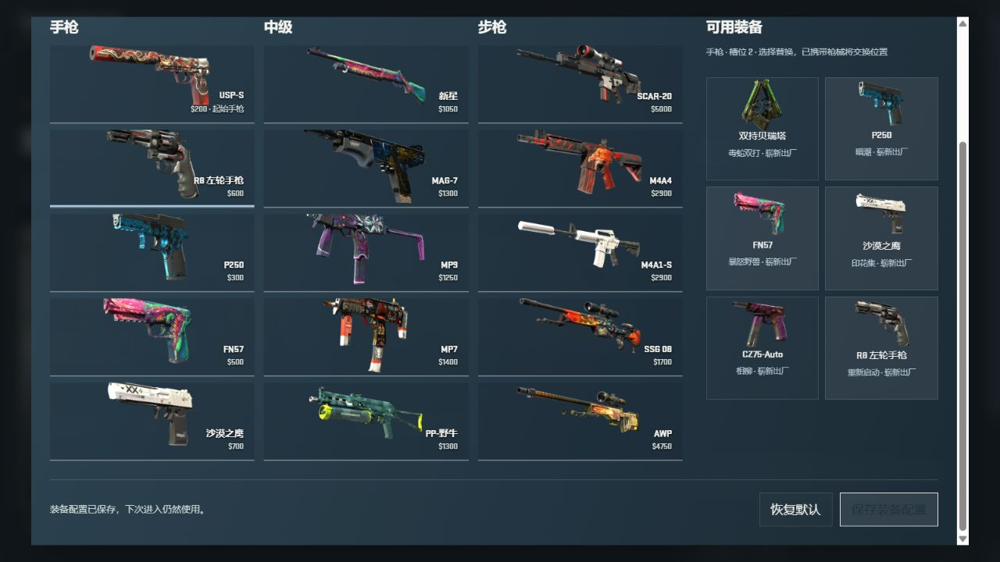

# CounterFlame 公开功能参考与独立实现范围

核查日期：2026-10-23。本文记录官方公开信息与 dust2-web 的源码对照；没有安装或运行 CounterFlame，也没有访问其私有仓库。

## 项目身份与公开源码状态

用户提到的手机项目是 **CounterFlame**，由 ScarletWork 开发。其官方入口为：

- 官网：<https://counterflame.com/>
- GitHub 组织：<https://github.com/scarlet-work>
- 官方组织简介源码：<https://github.com/scarlet-work/.github/blob/main/profile/README.md>
- 官方公告频道：<https://t.me/s/counterflame>

组织简介明确写着“Рабочие репозитории закрыты.”，意为“工作仓库私有”。本次查看组织时仅发现用于展示简介的公开 `.github` 仓库；没有发现公开的游戏源码或游戏代码开源许可证。因此，本次不能将 CounterFlame 描述成开源 CS2 手机游戏，也没有可供合并的官方游戏源码。

官方频道自述为 ScarletWork 的非官方 Android/iOS 粉丝项目，与 Valve 无关。官网和发布帖列出的功能属于开发者公开介绍，不等于本次已经验证这些功能的实际画面、手感或性能。

## 官方公开功能与本项目对照

| 官方公开信息 | 一手来源 | dust2-web 已具备的对应能力 | 仍可参考的方向 |
| --- | --- | --- | --- |
| 1.2.1 公告包含陀螺仪，以及图形、灵敏度、手部位置和 HUD 改善。 | <https://t.me/counterflame/427> | `client/mobile-aim.js` 提供陀螺仪模式、两轴灵敏度、开镜倍率、反转和校准；`client/touch-controls.js` 提供触屏控制；触控布局可调整位置、大小和透明度。 | 让玩家容易理解每个武器的操作；分别调整普通滑动瞄准和开镜滑动瞄准速度。 |
| 1.3 公告包含新菜单和 HUD、17 把新武器、五类投掷物、Dust2、人机训练，以及移动、穿透与武器动画改进。 | <https://t.me/counterflame/438> | 当前公开版本已有 34 把可选枪械、装备携带、五类投掷物、Dust2/Mirage、战术人机和武器动画。R8 已有武器数据、模型与音效资源。 | 优先补齐已存在武器的完整操作链路；后续可考虑不受回合经济限制的固定靶试枪入口。固定靶试枪场不属于本轮实现范围。 |
| 1.3 预告称优化地图、模型和 FPS 稳定性；1.3.0.1 公告称改善服务器和伤害登记。 | <https://t.me/counterflame/433>、<https://t.me/counterflame/441> | `shared/render-quality.js` 已按画质限制渲染像素预算；`client/frame-settings.js` 已提供帧率上限；命中由服务器判定。 | 用真机持续运行、帧时间和网络条件验证优化结果；公告没有公开相关算法，不能据此推断 CounterFlame 的实现方式。 |

补充对照：`client/touch-controls.js` 已处理 `pointercancel` 和 `lostpointercapture`；`client/main.js` 已在失焦或切到后台时清理输入；Android 宿主也会分发失焦事件。这些是本项目现有实现。没有公开证据可据此比较 CounterFlame 的输入取消或生命周期内部设计。

## 本轮独立实现范围

以下工作根据本项目源码和操作需求独立设计。CounterFlame 仅作为公开产品行为的参考；没有复制、合并其代码、模型、贴图、动画或音效，也没有通过 APK 反编译获取实现。

1. **补齐 R8 操作链路。** 接通主攻击准备与取消、副攻击、对应精度和动画，并补齐音效预热。准备时间为本项目可调整的近似值，不宣称与 CS2 原版时序完全一致。
2. **R8 触屏副攻击支持拖动瞄准。** 复用本项目多指输入与拖动瞄准机制，使副攻击按钮能保持射击意图并同时调整视角；按钮文本随当前武器变化，避免将 R8 副攻击显示成“开镜”。取消触控、打开菜单或进入后台时必须释放操作。
3. **独立触屏开镜灵敏度倍率。** 将触屏滑动的开镜倍率作为单独设置，保留既有陀螺仪开镜倍率。移动瞄准应遵循当前视野和本项目已有的输入换算，不将鼠标、触屏与陀螺仪的设置混为一个值。
4. **Android 邀请单次加载。** 检查冷启动与运行中接收邀请的加载路径，避免同一邀请重复触发页面加载；保留房间邀请语义。这是本项目入口和生命周期代码的修复，CounterFlame 公告没有公开这一实现。

本节描述本轮工作范围；最终实现状态、具体修改和验证结果应以配套提交及下面补录的测试结果为准。

## 验证范围

本次网络核查只确认了上述官方公开陈述及源码公开状态。未验证 CounterFlame 的实机表现，也没有做两款游戏的 FPS、温度、耗电、网络延迟或操作手感对比。

dust2-web 本轮实现已完成：

- `shared/touch-input.js` 的 `touchActionKind` 只让 R8 副攻击与主开火一样支持拖瞄，其他武器副键保持原行为；多个手指仍独立拥有移动和战斗操作。
- 触屏设置新增 0.2–2.5 倍的“开镜触屏倍率”。默认 1 保持旧配置手感，只有 FOV 小于 90° 时参与缩放；不改变普通触屏、鼠标或陀螺仪灵敏度。配置仍随现有设置备份保存。
- Android `MainActivity.onNewIntent` 保留现存 WebView，只导航一次；渲染器不存在时才恢复创建，避免销毁再加载和重复注册资源拦截。

可执行的移动端回归：

```powershell
node --test --test-concurrency=1 tests/android-invite-lifecycle.mjs tests/android-download.mjs tests/touch-controls.mjs tests/mobile-fullscreen.mjs tests/mobile-aim.mjs tests/mobile-aim-controller.mjs tests/mobile-assets.mjs tests/online-sync.mjs
npm run build
```

上述移动端回归 54 项通过；连同 R8、装备、射击、换弹和网络相关的 26 个测试文件，共 **176 项通过，0 失败、0 跳过**。生产构建通过。Android 邀请测试通过 JDK 编译执行生产 `onNewIntent` 方法及 Android 替身，覆盖已有渲染器复用、连续邀请、渲染器恢复和无效邀请；在原实现上能复现重复创建缺陷。完整 `MainActivity.java` / `MotionBridge.java` 另通过 Java 17 目标、Android 35 / AndroidX Webkit API 编译。

实际浏览器验证范围：从本地构建根入口打开设置，将开镜触屏倍率改为 0.75 后重新载入根入口，确认值仍为 0.75，普通触屏灵敏度保持 1.00；在装备菜单将 CT 手枪槽 2 改为 R8 并保存，页面显示保存成功。截图均来自这次本地浏览器，未修改图像。





未把本地静态服务的生产深路径路由视为完整部署验收，也未进行三维持枪开火和声音试听。本次没有产出新 APK；完整打包所需的 Gradle 9.3.1 与 installed-client 尚未准备，Java/API 编译不等于 APK 打包。手机上的触控舒适度、陀螺仪、持续帧率、温度、耗电和真实邀请恢复仍需真机验收；没有与 CounterFlame 做性能对比。
