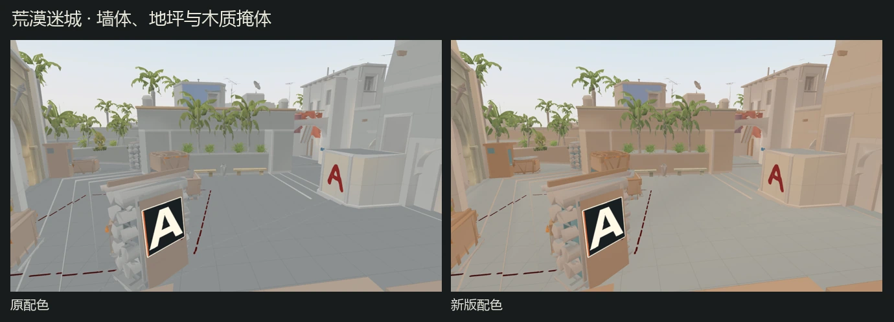
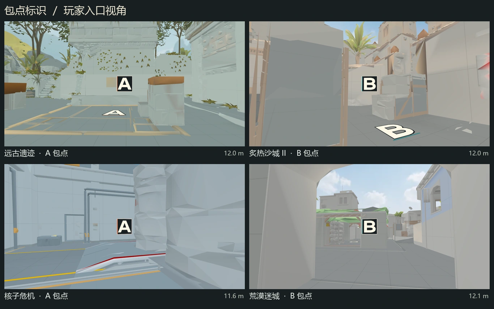

# 九图建筑材质与包点标识

高帧率模式的每张地图各用六种建筑涂色，供墙板、金属、木料、灰泥、铺地和砌块使用。荒漠迷城的灰泥带浅陶色，地坪偏灰；核子危机的墙板是冷灰蓝，木箱则保留暖色。墙面上褪色的漆和高饱和度的地标从原始顶点色中取色。网页版与 Blender 工程都读取同一份[九图配色表](../client/arena-finishes/palette.json)。



建筑涂层按地图、表面类型和原网格面面积分析烘焙颜色的亮度分布。着色器先压低凸面高光和浅坑阴影的局部起伏，再叠上平涂颜色与低反差板缝。窗洞和掩体仍有清晰的明暗边界。九个相同机位的几何蒙版在更新前后逐像素一致，地图共使用 3,633,871 个三角面。

A、B 使用粗笔画字母和明暗轮廓，字形与底色提供两种识别依据。核子危机与殒命大厦复用原位置的墙牌。其余七图保留地面标记，并将入口可见的字印在有连续支撑面的实体墙上。墙印复用现有网格批次和地面标识的图集。替换旧漆前会核对地图源、渲染描述及二进制几何的指纹。



## 在 Blender 中审阅

[材质库](../scripts/maps/materials/architectural-planes.blend)内有六种独立可编辑的表面。包含建筑、包点和按图打包的天空的九个完整工程可从[发行页](https://github.com/ETO-ze/dust2-web/releases/tag/online-v1.4.0-perf.6)下载，文件名为 `nine-map-paint-and-skies.zip`。工程使用 Blender 5.0.1 制作，打开后可切换到材质预览。项目原创代码采用 MIT，原游戏地图和图像的权利归属见[第三方说明](../THIRD-PARTY-NOTICES.md)。

## 网页运行

[九图游戏发行版](https://github.com/ETO-ze/dust2-web/releases/tag/online-v1.4.0-perf.6)已包含本版客户端。按[运行说明](NINE-MAPS-LOBBY.md#安装)解压程序、地图和素材即可试玩。网页运行时按所选地图加载对应天空。

## 编辑与重烘焙

在仓库根目录运行以下命令。先在 Blender 中编辑原创材质库的节点组，将修改保存为 `My-Finishes.blend`，再运行烘焙。脚本同时输出网页使用的 512 × 512 单通道纹理数组和可编辑库。

```sh
blender -b -t 4 --python-exit-code 1 -P scripts/maps/bake-arena-finishes.py -- artifacts/planes/Surface-Library.blend --source-blend My-Finishes.blend
npm run build
```

也可以使用已有游戏发行包的几何从头建立校准输入。下列命令将九个场景写入 `artifacts/arena/scenes`。生成的中间纹理写入 `client/map-finishes` 供 Blender 使用。网页只加载新版共用图集。请把地图包路径替换为实际位置。

```sh
blender -b -t 4 --python-exit-code 1 -P scripts/maps/bake-map-finishes.py -- --studio artifacts/crisp/Map-Finishes.blend
blender -b -t 4 --python-exit-code 1 -P scripts/maps/bake-arena-finishes.py -- artifacts/arena/Surface-Library.blend
blender -b -t 4 --python-exit-code 1 -P scripts/maps/assign-arena-finishes.py -- artifacts/crisp/scenes artifacts/arena --maps-v1 /path/to/maps-v1
```

重新校准色阶时使用上一阶段的带原始顶点色和材质槽的九个建筑工程作为输入。在源码树的 `client/plane-finishes.json` 中可查看每张图各类表面的校准参数。

```sh
blender -b -t 4 --python-exit-code 1 -P scripts/maps/author-plane-finishes.py -- profile artifacts/arena/scenes artifacts/planes
blender -b -t 4 --python-exit-code 1 -P scripts/maps/author-plane-finishes.py -- scenes artifacts/arena/scenes artifacts/planes
```
