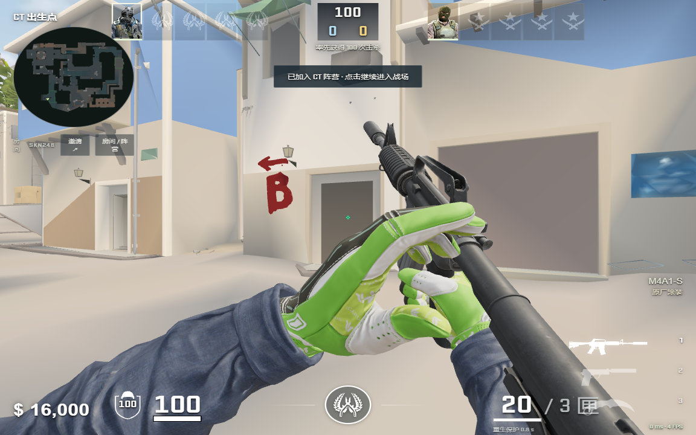

# 九图地图池与 216 款可装备外观

发行标签为 `online-v1.4.0-perf.4-216`，客户端标识为 `1.4.0-perf.4`。[下载本版附件](https://github.com/ETO-ze/dust2-web/releases/tag/online-v1.4.0-perf.4-216)

## 进入房间前会加载什么

九张地图各自使用对应的地形、碰撞、导航和爆破区。高帧率地图随发行包提供。网关可以为沙二、米拉吉、炼狱小镇识别另行挂载的同版本原版画面资源，按实际可用的资源开放高画质模式。

皮肤库和房间共用同一份目录，包含 34 把枪和刀具栏的 216 款外观。与上一轮的 60 款相比，增加了 34 款枪械原厂外观、102 款热门涂装和 20 款原厂刀型。每把枪的三款热门涂装来自本次选取时的近 30 天成交数据。另有一款随探员装备的手套。游戏内的完整清单可以筛选并导出 CSV，参考目录与可装备项目分别列示。

加入现有房间前，服务器返回房内探员和武器外观 ID。客户端先准备探员、手臂、玩家自己的起始装备和房内手持武器，并在手机与桌面各自的预算内解码备用武器。其余携带或掉落的外观先按哈希缓存文件。如果入房前房内装备发生变化，客户端补齐变化的部分。新房间按起始装备和人机配置准备资源。



公开源码回归共运行 681 项，677 项通过，4 项需单独指定地图目录的用例跳过。公开源码重新构建出的 75 个客户端文件逐字节匹配发行程序包的客户端构建。

本地双客户端验证中，加入者保存了 M4A1-S 原厂外观，取得房内 AK-47「墨岩」的外观清单，在发送加入请求前只下载一次对应模型。九张地图均已用一个测试客户端和九名人机验证房间加入。浏览器的光照与磨损烘焙由网页渲染器实现。模型、贴图、库存图和第三方工具的归属见[素材说明](ASSETS.md)。

## 运行发行包

需要 Node.js 22.12 或更新版本、npm 和 tar。从发行页下载 `game.tgz`、`maps-v1.tgz` 和 `SHA256SUMS.txt` 到同一目录。以下命令适用于 Linux、macOS 的兼容工具环境或 WSL。Windows 可用 `Get-FileHash -Algorithm SHA256` 校验文件，并通过 PowerShell 的 `$env:NAME = 'value'` 设置同名环境变量。

```sh
sha256sum -c SHA256SUMS.txt
mkdir -p game maps-v1
tar -xzf game.tgz -C game
tar -xzf maps-v1.tgz -C maps-v1
cd game
npm ci --omit=dev
export PERF_MAP_ROOT="$(cd ../maps-v1 && pwd)"
export PERF_GAME_DIST="$PWD/dist"
export PERF_ASSET_BASE_URL="https://downloads.duskrain.cn/releases/20261011-armory-02/assets/"
PORT=3240 node server/performance-maps.js
```

在浏览器中打开 `http://127.0.0.1:3240/perf/`。程序按需启动地图进程。新外观、动作和库存图随程序包提供，共用基础素材从已有 CDN 获取。可通过 `PERF_PUBLIC_DIR` 指向已有完整素材的 `public` 目录。可选的 `PERF_QUALITY_MAP_LIBRARY` 和 `PERF_QUALITY_TRANSPORT` 分别指向原版地图导出和匹配的传输包，网关核对签名后启用相应入口。

## 从源码构建九图客户端

在本标签的源码目录执行下列命令。将文件路径替换成已校验的发行附件位置。基础资源按锁文件下载，新外观和完整清单从同版程序包恢复至 `public/assets`。

```sh
npm ci
npm run assets:fetch
tar -xzf /path/to/game.tgz -C public --strip-components=1 dist/assets/weapons/cs2-skins
mkdir -p artifacts/performance-maps/maps-v1
tar -xzf /path/to/maps-v1.tgz -C artifacts/performance-maps/maps-v1
npm run build
PERF_GAME_DIST="$PWD/dist" npm run start:perf
```

Windows 默认端口为 33440，其他系统为 3240。设置 `PORT` 可指定端口。部署到已有站点时，需要让反向代理把整个 `/perf/` 路径及 WebSocket 升级请求转给网关。

历史版本的 Android、Windows 和离线包继续从各自的发行页提供。[安装包下载](https://github.com/ETO-ze/dust2-web/releases/tag/online-v1.2.0-cdn.1)
