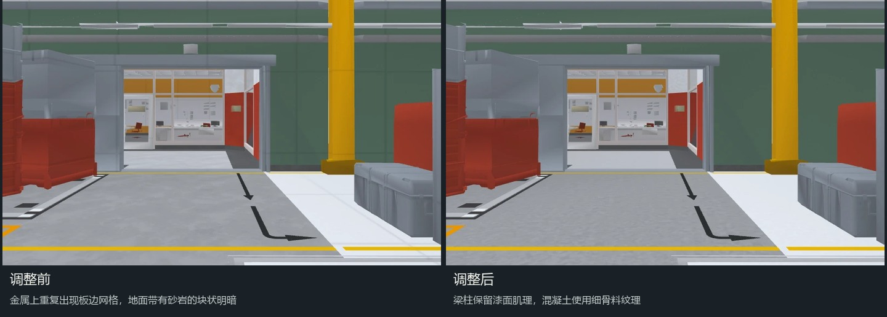

# 九图联机大厅运行说明

发行标签 `online-v1.4.0-perf.5` 对应客户端 `1.4.0-perf.5`。[下载程序、九图地图包和校验文件](https://github.com/ETO-ze/dust2-web/releases/tag/online-v1.4.0-perf.5)

## 安装

准备 Node.js 22.12 或更新版本、npm 和 tar。将三个附件放在同一目录。在 Linux、macOS 的兼容工具环境或 WSL 中执行以下命令。

```sh
sha256sum -c SHA256SUMS.txt
mkdir -p game maps-v1
tar -xzf game.tgz -C game
tar -xzf maps-v1.tgz -C maps-v1
cd game
npm ci --omit=dev
export PERF_MAP_ROOT="$(cd ../maps-v1 && pwd)"
export PERF_GAME_DIST="$PWD/dist"
export PERF_ASSET_BASE_URL="https://downloads.duskrain.cn/releases/20261011-armory-02/assets/"
PORT=3240 node server/performance-maps.js
```

启动后打开 [本机地图池](http://127.0.0.1:3240/perf/)。Windows 可用 `Get-FileHash -Algorithm SHA256` 校验，PowerShell 使用 `$env:变量名 = '值'` 设置环境变量。网关监听本机地址，对外提供服务时须在反向代理中转发整个 `/perf/` 路径及 WebSocket 升级请求。

## 房间和素材

九张高帧率地图随包提供。角色、武器与地图按进入的房间加载。通用基础素材可来自 CDN，已有完整本地素材时，可将 `PERF_PUBLIC_DIR` 指向对应的 `public` 目录。

高画质模式需要同版本的原版素材库。可通过 `PERF_QUALITY_MAP_LIBRARY` 和 `PERF_QUALITY_TRANSPORT` 指定原版导出及相应的传输包。网关会校验导出、模型、纹理与玩法数据的版本，页面按实际可用素材开放画质选项。两种画质使用同一个房间进程。

进入地图选择页即可查看有真人的公开房间。进房后可选择阵营，由房主配置人机。大厅标出仍能加入的真人数，人机可为进入的玩家让位。

## 从源码构建

在本版标签的源码目录执行。将下方路径替换为本地发行附件的实际位置。

```sh
npm ci
npm run assets:fetch
tar -xzf /path/to/game.tgz -C public --strip-components=1 dist/assets/weapons/cs2-skins
mkdir -p artifacts/performance-maps/maps-v1
tar -xzf /path/to/maps-v1.tgz -C artifacts/performance-maps/maps-v1
npm run build
PERF_GAME_DIST="$PWD/dist" npm run start:perf
```

## 在 Blender 中编辑高帧率地图

在源码目录运行以下命令，将发行包中的核子危机导入 Blender，并保存为可编辑场景。可将地图目录替换为其余八图。场景随文件打包六种建筑表面纹理，实际对战使用客户端的共享着色器渲染。

```sh
blender -b --python scripts/maps/blender-material-review.py -- /path/to/maps-v1/de_nuke Nuke-Materials.blend
```

本次用 Blender 5.0.1 导入九张地图并重新烘焙共享纹理。金属、混凝土和斜面的变化在浏览器中按同一机位复核。



## 已验证的范围

- 每张地图分别用一个客户端和九名人机验证进房、十人快照与退房。两种画质的客户端在荒漠迷城成功加入同一房间。
- 使用游戏的玩家碰撞与移动验证了九图从两个阵营出生点到 A、B 包点的 36 条路线。核子危机工业门与炼狱小镇中已禁用的物件按原始地图实例修复。
- 核对了 165 项涉及特殊布局或非物理几何的碰撞。九图渲染文件从 93.49 MB 减到 85.70 MB，绘制批次数仍为 542。为保留格栅开孔与窄边轮廓，三角形总数增加了 14.8%。这些数据描述地图资源规模，手机实测帧率另计。
- 地图选择和对战准备页用桌面、手机竖屏及手机横屏尺寸验证。公开房间、阵营选择与房间席位均使用实际对局数据。

[返回项目首页](../README.md) · [地图、外观及第三方素材来源](ASSETS.md)
