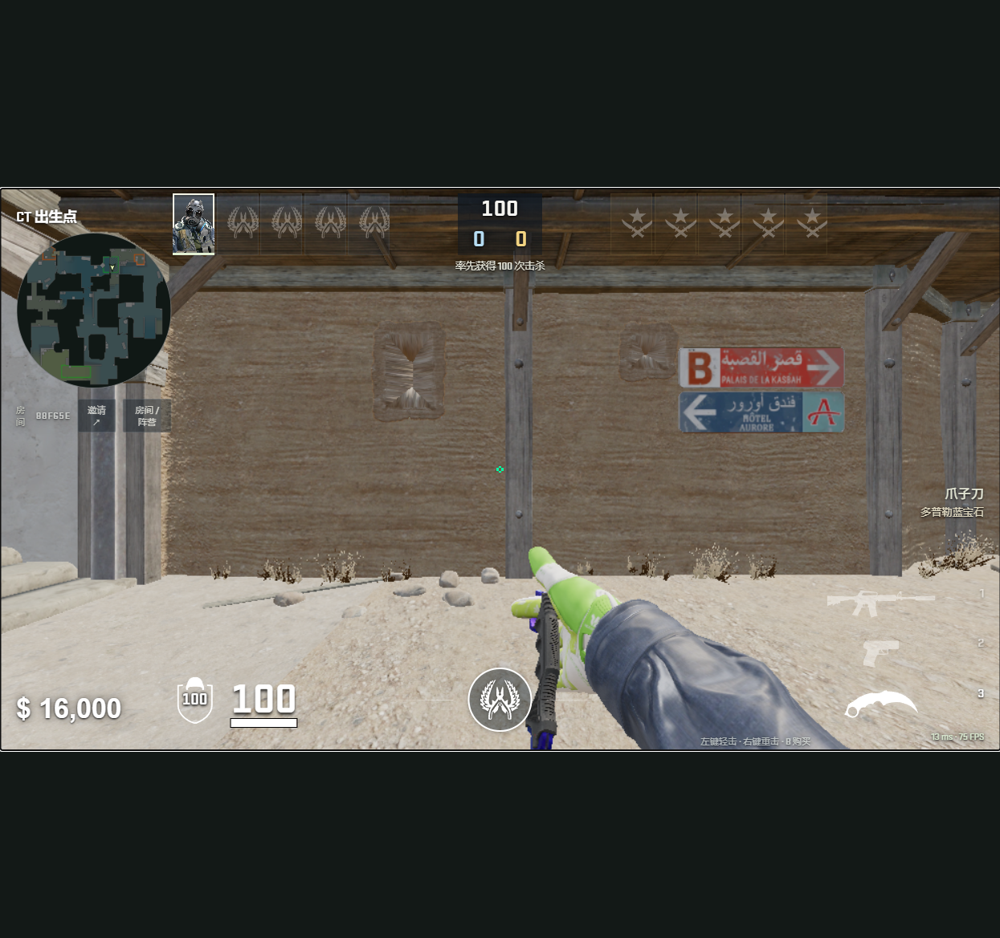

# 网页版 1.3.0：沙二更新与共用装备界面

## 发布范围

- 网站默认入口与沙二对战同步最新客户端、服务器逻辑和共用素材。
- 米拉吉同步 HUD、键位、装备携带、武器、皮肤和检视操作；地图资源、碰撞签名、导航、跳点和地图专用人机控制器保持现有版本。
- Android、Windows、GeckoView 和独立离线安装包本次未重新打包。旧包继续使用原资源版本，网页使用独立的 1.3.0 下载配置。

## 更新内容

**装备与皮肤。** 补齐 34 把枪械；每个阵营配置手枪、中级和步枪各 5 个携带槽。CT 起始手枪支持 USP-S／P2000。提供 50 款皮肤和 35 个崭新默认外观，沿用玩家已保存的选择，武器模型和新增动画按装备需要下载。新加入 AUG、FAMAS、G3SG1、P2000、CZ75-Auto、R8、MP5-SD、P90、UMP-45、M249 和 Negev。

**共用 HUD 与操作。** 使用提取的 CS2 图标与字体重新组织局内信息，护甲数值位于盾牌中央，拆弹器移至左侧，装备集中在右下。商店使用有界顺序购买队列，连续购买不再全局禁用按钮。装备保存由服务器确认，并纳入设置备份。

**检视与观战。** 检视期间重复 F 保持动画进度；R 可取消检视，爪子刀、M9 和蝴蝶刀的 FR 动作平滑切换。换弹、安拆 C4、投掷和菜单状态遵循操作优先级。己方全员阵亡且 C4 已安装时，死亡过渡后自动观战 C4；未安装的炸弹不会通过该视角暴露。

**沙二人机。** 枪声、脚步、落地、换弹和道具声提供带反应延迟的近似位置；瞄准和开火依然需要视觉确认。战术覆盖默认控图、假打、ECO 集结、突破和道具时序。保留普通默认、平滑视觉瞄准、连输 2 回合增强与连赢 2 回合恢复，以及 Vitality 风格规则挑战。比赛回放统计用于规则与倾向设计，未训练职业选手模型。

## 资源与兼容

新共用素材使用独立的不可变 CDN 版本；米拉吉地图继续读取原地图版本。下载按 SHA-256 校验，缓存中的相同资源继续复用。额外皮肤、刀型与动画按需下载。公开源码的素材锁文件指向对应 CDN，开发者可使用 `npm run assets:fetch` 获取匹配版本。

仍使用网页渲染器和权威联机服务器，未运行 Source 2 或 Panorama。外观基于原始模型、UV 和磨损为 0 的材质制作，网页 PBR 与 CS2 着色器存在表现差异。R8 蓄力扳机和 FAMAS 三连发机制未在本次新增。

## 验证范围

公开源码回归：642 项，639 通过，3 项原始地图资源条件跳过，0 失败。另已验证完整武器库、P2000 起始手枪保存和重生、AUG 下载与开火、连续购买／退枪、皮肤保存和刀具检视衔接。配图来自真实本地浏览器运行。

已上线 [cs2.duskrain.cn](https://cs2.duskrain.cn/)，客户端 1.3.0。生产发布通过空房检查与临时加入保护，保留旧版并配置失败自动回滚。

- CDN 1,738 个文件、510,077,100 字节完成公网 SHA-256、响应元数据、CORS 和范围读取校验，0 失败。
- 沙二与米拉吉均完成真实公网 WSS 1 真人＋9 人机加入、P2000 起始手枪和装备保存确认，退出后房间清空。
- 米拉吉地图与碰撞签名、地图专用路线控制器和跳点代码保持一致；其他私有地图服务未重启。
- 新版网页与旧安装包分别读取独立资源配置，原下载入口保留。
- 正式站浏览器已打开新装备菜单，显示 34 款枪械；无控制台错误。

P60 真机、十名真人长时压力以及全部 34 把枪的每个动作尚未完成逐项人工验收。

